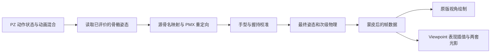

# 游戏中的动作、持物和物理

本文对应 Git 主分支的 0.7.15 维护基线。游戏控制角色的动作状态、移动、碰撞与伤害。框架读取游戏完成的骨骼姿态，用授权的模型会话画出少前2人物。游戏仍负责决定走、跑、蹲、翻越、攻击或开车用哪组动画以及怎样混合。

## 从游戏角色到模型会话

[Main](../../game/java/aimoh/pmxpreview/Main.java) 根据 `GFL2Exilium` 的实际 MOD 目录读取 `media/aimoh_pmx/registry.json`。Lua 通过 [AimohPMXPreview](../../game/java/aimoh/pmxpreview/AimohPMXPreview.java) 访问这个入口。每个实际角色对象各有会话，状态由 `pending`、`preparing` 和 `active` 三张表持有。

| 阶段 | 进入条件和行为 |
|---|---|
| 原版／未替换 | 没有可用人物会话时，游戏原绘制正常提交。Lua 读取到保存的造型时，先排队恢复。 |
| `pending` | 启用、读档、联机外观等操作先排队。捕获该角色时，`sessionForCapture` 才处理请求。模型相同且已正常工作时，可以在同一会话上应用设置。 |
| `preparing` | 新会话解析 PMX、配置和贴图，取得实际姿态，准备网格。在这一期间，旧会话仍可绘制。首次启用仍可显示原版。 |
| `active` | `completeCapture` 仅提交当前登记且已就绪的候选。Lua 确认提交成功后才记住选择、通知本机语音并发布联机外观。 |
| 失败／取消／退役 | 新候选失败时退役候选并记录切换失败。已有会话留作回退。更晚到达的旧准备帧失去替换资格。退出、死亡和换角色的释放按图形资源所有权排队。 |

失败与就绪是两个不同的状态。换装失败时旧会话可能仍然就绪，Lua 必须先看 `hasModelFailure`，才能区分成功和回退。测试和异常收尾见 [生命周期修正记录](../runtime-lifecycle-0.3.6.md) 和 [组件夹具](../../tools/java/LifecycleCheck.java)。

## 一帧里怎样更新

1. [PzPoseCapture](../../game/java/aimoh/motion/PzPoseCapture.java) 从 `AnimationPlayer` 读取骨骼矩阵。[ModelSession.pose](../../game/java/aimoh/pmxpreview/ModelSession.java) 根据 profile 的骨名映射重新索引，必要骨缺失时报错。可选骨缺失时以 profile 的参考数据补齐。走、跑、蹲、翻窗和跨栏都从这一入口进入。
2. [WorldPoseRetargeter](../../game/java/aimoh/motion/WorldPoseRetargeter.java) 使用源参考姿态、目标骨架的父子关系和比例，将游戏世界骨骼姿态转换为目标 PMX 的局部姿态。持物时再以源手部数据和目标掌心求握持修正。细节依赖相同的骨名、绑定和单位，单独修改其中一项会影响多个动作。
3. [ModelSession.update](../../game/java/aimoh/pmxpreview/ModelSession.java) 按游戏帧号去重。新帧从捕获时间计算物理步长，首帧为零，单次推进上限为 0.08 秒。用来校准姿态的中间评价采用 `dt=0`。同一帧再次捕获可更新第一人称显隐、改用已经完成姿态的 CPU 蒙皮或准备当前后端网格，动作和物理只推进一次。
4. [ModelPhysics](../../game/java/aimoh/motion/ModelPhysics.java) 在最终姿态提交时统一处理物理启停和重置，再推进运行时。需要延后蒙皮时调用 `UpdateModelPose`，需要本机 CPU 顶点时调用 `UpdateModel`。姿态计算完成后才生成位置、法线、材质状态和渲染资料快照。
5. 游戏原版视角从 [VanillaWorld.capture](../../game/java/aimoh/pmxpreview/VanillaWorld.java) 接手，启用 Viewpoint 时从 [CapturePatch](../../game/java/aimoh/pmxpreview/CapturePatch.java) 与 [Bridge](../../game/java/aimoh/pmxpreview/Bridge.java) 接手。两边复用模型会话、人物资源和姿态。进入绘制阶段后，表现层按快照采样。

## 各种游戏状态

| 状态 | 实现和修正 | 升级后的观察点 |
|---|---|---|
| 空手普通站立 | [IdleHandPose](../../game/java/aimoh/pmxpreview/IdleHandPose.java) 只在空手、动作上下文为普通 idle 且没有子状态时过门控。目标手型来自 `Bob_Walk` 25% 的手指参考，渐入渐出，现行公共强度为 70%。 | 手型换入和走动恢复，切片时手指朝向和手掌比例。 |
| 移动、蹲、坐下、攀爬、攻击及其它动作 | 继续读取当前游戏骨骼。移动、潜行、瞄准、坐下、攀爬、攻击和正在执行交互等会退出空手 idle 修正。 | 测进入、退出和混合过程，例如站到蹲走、翻窗、跨低栏、攻击回到站立。动作里的肢体与衣料回归要分开看。 |
| 全身表情和舞蹈朝向 | [SourcePoseGuard.usesAuthoredEmoteFacing](../../game/java/aimoh/pmxpreview/SourcePoseGuard.java) 判定正在播放、具有混合权重并影响根骨和头骨的 emote。舞蹈朝向归全身动作，避免瞄准扭转跟着改头。 | 全身转向与退出表情时朝向，局部表情的骨骼权重要保持原行为。 |
| 持枪、近战、双手物品 | 游戏提交物品本体和附件变换。框架以完成的 PMX 掌心重映射物品。握持链包括掌心校准、Ozz 双骨 IK 和手腕方向恢复，物品校准可分站姿与瞄准。 | 左右手、枪与近战切换、换物品、换配件。瞄准和站姿各查一次，避免因保存键错误串值。 |
| 第一人称、瞄准、车内 | Viewpoint 路径以 `hideHead` 和车辆状态区分第一人称，第一人称用头部锚点，车内用骨盆座位锚点。兼容的 EFZ 第一人称持枪状态可保留外部持物矩阵，目标手腕跟随实际手部姿态。 | 开关第一人称、进入瞄准、进出车辆、切回第三人称。应分别观察相机锚点、头部显隐和枪的摆放。 |
| 本地 VMD 动作 | 整备室选择本地或内置 VMD，通过 [ReadyRoomPreview.motionCommand](../../game/java/aimoh/pmxpreview/ReadyRoomPreview.java) 控制当前本机玩家的会话。游戏移动、瞄准、攻击、上车或死亡会使正常播放条件失效。 | 暂停、拖动、倍速、停止、角色切换和退出后，要核对动作层、临时物理状态和旧进度条。 |
| 暂停、镜头切换、断帧 | 模型处于同一游戏帧时继续用该帧姿态。镜头切换、历史不连续或拓扑变化时，表现层重置插值历史。暂停期间的相机重捕获复用已缓存的持物局部矩阵。 | 暂停绕人物、恢复时间和快转相机。对照手与枪是否同时到位，角色阴影与透明件是否还在正确位置。 |

## 持物位置为什么要分捕获和插值

以 0.7.14 的 [持物发布记录](../../provenance/releases/0.7.14-held-slot-attachment.json) 为准。

- 游戏 `ModelInstanceRenderData.xfrm` 包含手部槽位和物品脚本的附件位置。捕获时以身体矩阵的逆乘物品矩阵，得到进入 Viewpoint 放置变换之前的物品局部位置。[Bridge.heldSource](../../game/java/aimoh/pmxpreview/Bridge.java)
- [ModelSession.attachment](../../game/java/aimoh/pmxpreview/ModelSession.java) 将手持物品映射到目标手。其他装备沿原父骨到可映射的祖先。游戏脚本安装点参与定位。站姿、瞄准和物品调校从 [GripCalibration](../../game/java/aimoh/pmxpreview/GripCalibration.java) 读取。
- [ViewpointModel.captureHeld](../../game/java/aimoh/pmxpreview/ViewpointModel.java) 按已经蒙皮的顶点数组保存局部持物矩阵。同一姿态中仅改变材料或显隐的快照共用这一份结果。相同物品实例和模型网格可读取前一帧、前两帧。物品身份变化时回到当前结果。
- [PmxPresentation.timing](../../game/java/aimoh/pmxpreview/PmxPresentation.java) 使用宿主 phase 选择两份快照。常规 phase 在前帧与当前帧间采样，负 phase 在更早帧与前帧间采样。手部网格和持物局部矩阵共用相同端点与权重。宿主 `ModelBlend.drawn` 后，再将持物局部矩阵乘实际用于绘制的人物根。这样检查枪先动或手先动时，可以先对齐共同时间采样，再讨论握持参数。[RenderPatch](../../game/java/aimoh/pmxpreview/RenderPatch.java)

## 身体、衣物和胸部物理

- PMX 刚体和关节由 [MMDPhysics](../../native/mmd-engine/src/physics/mmd_physics.rs) 读入 Bullet。现行配置是 60 Hz 固定步长、单次调用最多 5 个子步。运行时用最终骨骼姿态同步随骨刚体，按角色位移变化施加惯性，再把动态刚体结果合并回骨骼。随后计算子骨和网格。[物理配置](../../native/mmd-engine/src/physics/config.rs) · [外部姿态合并](../../native/mmd-engine/src/external_input.rs)
- 身体物理总开关控制现装模型的次级物理。胸部模型还要有与 PMX SHA、顶点数和骨骼数对应的局部绑定数据，并满足自己的开关。JAR 内置资源和模型目录的 `chest.bin` 都有各自加载入口。现行胸部运行时使用 Jolt 局部体积、跟随和输入惯性，设定值由代码统一给出，旧存档中可能有滑条数据，当前求解值以统一预设为准。[PmxModel](../../game/java/aimoh/motion/PmxModel.java) · [ChestSoftBody](../../game/java/aimoh/motion/ChestSoftBody.java) · [胸部惯性](../../game/java/aimoh/motion/JoltChestMotion.java)
- 刚体开关切换或手动重置在完成姿态后重建状态。胸部软体失败时保留正常网格并记录故障，可通过物理重置重试。性能诊断中的 `retarget_rigid_ms`、`chest_ms` 和 `capture_cpu_ms` 各覆盖不同组件。
- 服装和头发的正式路径仍是 PMX 刚体骨链。大动作时裙面穿透属于现存视觉限制。独立 XPBD 布料试验未进入发布源码或正式素材，维护时以现装方式重现。

## 两个需要保留的异常恢复

**姿态被显示修改器写坏。** [SourcePosePatch](../../game/java/aimoh/pmxpreview/SourcePosePatch.java) 与 [SourcePoseGuard](../../game/java/aimoh/pmxpreview/SourcePoseGuard.java) 只为人物系统拥有的角色记录本次动画评价。读取异常共享矩阵时，先用当前动画局部矩阵让游戏重建，局部数据损坏时再尝试当前评价的有效参考。正常矩阵和真实动画零缩放保留其语义。修正后让游戏的蒙皮缓存失效。早期已用实际动画评价受控复现 ADS 的零缩放和 NaN 链，现场来源仍以实际日志为准。[原始修正与回归范围](../source-pose-0.3.8.md)

**切角色与贴图释放。** 预览会话和游戏会话分别拥有模型和贴图。切换失败保留原先活动会话，退出时按所在后端的队列与退役设施逐项释放。贴图解码分配器和释放方式必须配对，旧版原生崩溃的一类原因是 STB 图像所有权错误。修复管道见 [贴图释放记录](../texture-release-fix.md)。进一步的 Viewpoint 网格池问题和释放时机见 [光影章](rendering.md#切包和资源退役)。
